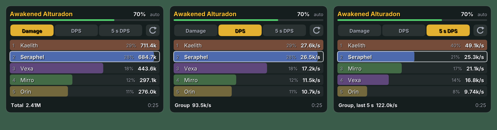

# aion-cube-overlay

Two overlays for Aion 2 on Linux (Wayland):

- a **Hidden Cube radar**: a small, click-through overlay in a corner of the screen that shows where the nearest
  cube is and **how far above or below you** it is;
- a **DPS meter**: its own window, which you drag wherever you like, showing every character's damage on the
  enemy you are fighting.


It reads the game's network traffic, like the Windows tools do. It never sends anything to the game or changes
it. The decoding is the one from [aion2-tui](https://github.com/Ottitsch/aion2-tui) (crates `aion-net`,
`cube-core` and `meter-core`, copied unchanged from commit `028168c`). This project adds Linux capture, the
overlay windows, the radar's height display and the per-enemy meter.

## What it shows

- **Radar, north up**, with you in the middle and rings at 25, 50 and 100 m. The game sends a cube once you are
  within about 100 m of it.
- **Height in the marker's shape:** ▲ the cube is more than 2 m above you, ▼ more than 2 m below, ● about level.
  Cubes off your level also carry a `+12 m` / `−9 m` label.
- **Height gauge** on the right: you are the white line, every cube is a mark at its height. The scale grows
  from ±10 m up to ±500 m as needed.
- **Text:** `Cube 38 m NE`, then `12 m above you` (blue) or `9 m below you` (pink), and `+2 more`.
- Filled marker: the cube is in view. Hollow: it left your view but nobody opened it. Orange ring: someone is
  opening it. Red ✕: someone else opened it. Green ring: you opened it.
- Faint circles are spots where cubes were seen in earlier sessions. The faint line is your path.
- A banner and a flash of the rim when a new cube appears.
- **It hides itself when there is no cube.** It shows for a few seconds at start and when it starts reading the
  game, then stays hidden until a cube is near, and hides again 3 seconds after the last one is gone. Use
  `--always` to keep it up. The bottom line says why nothing shows, for example *map unknown until a loading
  screen* or *no cube type known for this zone yet*.

## DPS meter



The meter follows **one enemy** and lists every character hitting it, highest first, with a bar in the class's
colour, the share of the group and the value. Your own row is outlined and always shown, even when it isn't in
the top rows. Three modes, switched with the tabs:

| Tab | Shows |
| --- | --- |
| **Damage** | all damage the character dealt to this enemy |
| **DPS** | that damage divided by the time the enemy has been under attack (from the first hit anyone landed on it to the last), so every row uses the same clock and the rows add up to the enemy's damage per second |
| **5 s DPS** | a moving average: the damage dealt to the enemy in the last 5 seconds, divided by 5 (by the fight's length while it is shorter than that) |

- **Which enemy:** the one *you* hit last (`auto`), so switching to an add switches the meter. It goes back to the
  boss when your enemy dies or you stop hitting it for 15 s. **Click the enemy's name** to pin an enemy of the
  fight instead (`pinned`); clicking through all of them gets back to `auto`.
- **The header** shows the enemy's HP, the footer the group total in the mode and how long the enemy has been
  fought.
- **—** (top right) minimizes the meter to a single bar: the mode, your rank and value (`#2 you 16.5k/s`, or the
  leader's when you aren't in the fight) and the group's. The same button opens it again. Below the bar, clicks
  go through to the game, and the meter remembers being minimized.
- **↺** ends the fight and clears the meter; the next hit starts a new one. Fights also end on their own: when
  the boss dies, on a loading screen, after a wipe, or after 20 s without damage in the open world (3 min in a
  dungeon).
- **Drag** the meter anywhere by pressing on any part that isn't a button. **Turn the mouse wheel** over it to
  make it bigger (up) or smaller (down), 10 % a step. It stays above the game and remembers its place, size and
  mode (`~/.config/aion-cube-overlay/meter.json`). Only the drawn panel takes clicks; the rest goes through to
  the game.
- What counts as a player's damage is aion2-tui's decision: summons and spirits are folded into their owner,
  and false hits (heals, PvP records, hits on dead targets) are dropped. The meter reads it ten times a second,
  so the time under attack is exact to about 0.1 s.

Options: `--meter-mode damage|dps|5s`, `--meter-pos x,y`, `--meter-scale f`, `--meter-rows n` (default 8),
`--no-meter`, and `--no-radar` for the meter alone.

## Size

The meter starts at 1.25 times its base size, the radar at its base size (1). If the text is still too small:

- **Meter:** turn the mouse wheel over it. The size is saved.
- **Radar:** it lets every click through, so it can't be resized with the mouse. Use `--radar-scale 1.6`, or
  `--scale 1.6` for both. To keep it, put the option in `~/.config/aion-cube-overlay/options`:

  ```sh
  mkdir -p ~/.config/aion-cube-overlay
  echo '--radar-scale 1.6' >> ~/.config/aion-cube-overlay/options
  ```

  That file takes any option from this README, one or more per line, with `#` for comments. Options on the
  command line come after it, so they win.

On a HiDPI screen with an integer scale (200 %), the compositor's scale is applied on top, so the text stays
sharp.

### Limits

These come from the game's traffic, not from the overlay:

- **Your position only updates when you use a skill or dash.** The server never echoes your own movement. When
  your position is more than 10 s old, the distance gets a `≈`, the line to the cube is dashed, and the status
  line says so. Before the first position it shows `Cube detected` with a `?` in the middle.
- **No "turns with you" mode.** Your heading isn't in the traffic, so the radar is always north up.
- **North is assumed to be world −Y, but that isn't confirmed in game yet.** If the radar turns out rotated
  compared with the in-game map, fix it with `--north-offset 90` (or 180 or 270).
- **Only a few cube types are known from the start:** two in Verteron, plus one unconfirmed guess for Altgard.
  Every time you open a cube with a key, its type is learned and saved, so it's known from then on. You can also
  add one with `--template <id>`. A cube of an unknown type in a new zone won't show until you've opened one
  there.
- Tested on Aion 2 Global (port 13328), like aion2-tui. Use `--port` for another one.

Tools that read game traffic may be against the game's terms of service. Use it at your own risk.

## Install

### Arch, CachyOS, Manjaro

The repository has its own PKGBUILD. It builds the files as they are on disk, with no cloning or downloading of
the sources, and grants the capture permission on install and upgrade, so no `setcap` by hand. From the
repository root:

```sh
makepkg -si
```

After changing something, run `makepkg -si` again. The build output is kept in `src/target`, so rebuilds are
quick. `src/`, `pkg/` and the package file are ignored by git.

### Other distributions (or by hand)

You need Rust (from https://rustup.rs or your distribution) and the libpcap headers:

| Distribution | Package |
| --- | --- |
| Arch, Manjaro, CachyOS | `sudo pacman -S libpcap` |
| Fedora, Nobara | `sudo dnf install libpcap-devel` |
| Debian, Ubuntu, Mint, Pop!_OS | `sudo apt install libpcap-dev` |
| openSUSE | `sudo zypper install libpcap-devel` |

```sh
cargo build --release
sudo install -m 755 target/release/aion-cube-overlay /usr/local/bin/
# let it capture without running as root (run this again after every reinstall):
sudo setcap cap_net_raw,cap_net_admin=eip /usr/local/bin/aion-cube-overlay
```

Try it without the game:

```sh
aion-cube-overlay --demo
```

Then start Aion 2 and run `aion-cube-overlay`. It captures on every interface at once (`any`), so Wi-Fi,
Ethernet, PPPoE and VPNs all work. Use `--interface <name>` to pick one.

To start it with your desktop, add it to your compositor's autostart (`exec aion-cube-overlay` in Sway or
Hyprland, or *System Settings › Autostart* in KDE).

## Desktops

| Desktop | How it shows |
| --- | --- |
| KDE Plasma (Wayland), Hyprland, Sway, river, niri, Wayfire, COSMIC, labwc | Overlay layer, above the game. Clicks go through the radar; the meter is dragged and clicked. |
| GNOME | GNOME has no layer-shell, so both open as small borderless windows. Drag them with the left button. Right-click, then **Always on Top**. The radar takes clicks there too. |

Run the game in **borderless** or **windowed** mode. Most compositors also draw the overlay layer over true
fullscreen, but not all.

## Options

```
--demo                  scripted demo data, no capture
--replay <file>         play a saved .pcap or .pcapng at its own pace (--speed 4 for faster)
--interface <name>      capture on one interface only (default: all)
--port <n>              game port, repeatable (default 13328)
--template <n>          treat this object template as a cube, repeatable
--corner <where>        top-left (default), top, top-right, right, bottom-right, bottom, bottom-left, left
--margin <x>,<y>        distance from the screen edges (default 24,120)
--scale <f>             size of both overlays (default 1.25 for the meter, 1 for the radar; HiDPI outputs are handled automatically)
--radar-scale <f>       size of the radar alone (default 1)
--output <name>         monitor, e.g. DP-1
--range <m>             radar radius in metres (default 100)
--opacity <f>           background opacity 0 to 1 (default 0.5)
--north-offset <deg>    turn the map if north turns out to be elsewhere
--no-spots, --no-trail  less on the radar
--always                keep the radar up even without cubes
--alert-cmd <command>   run on a new cube, with CUBE_DISTANCE, CUBE_HEIGHT, CUBE_DIRECTION, CUBE_ALERT set
--window                normal windows instead of overlays
--png <file> [--at <s>] with --demo or --replay: draw one radar frame to a PNG (--meter-png for the meter)

--meter-mode <m>        damage, dps or 5s (default: the mode it was left in, else 5s)
--meter-pos <x>,<y>     place of the meter (default: where it was left, else 24,560)
--meter-rows <n>        characters shown at most (default 8)
--meter-scale <f>       size of the meter (default: as it was left, else 1.25; or the mouse wheel over it)
--no-meter, --no-radar  only one of the two
```

A sound when a cube appears:

```sh
aion-cube-overlay --alert-cmd 'pw-play /usr/share/sounds/freedesktop/stereo/bell.oga'
# or a notification:
aion-cube-overlay --alert-cmd 'notify-send "Hidden Cube" "$CUBE_DISTANCE m $CUBE_DIRECTION, height $CUBE_HEIGHT m"'
```

### Hotkeys

The overlay never takes keyboard focus, so it listens to signals instead: `SIGUSR1` hides or shows the radar,
and `SIGUSR2` pins it on.

```sh
# Hyprland (hyprland.conf)
bind = SUPER, F9, exec, pkill -USR1 -x aion-cube-overl
bind = SUPER, F10, exec, pkill -USR2 -x aion-cube-overl
# Sway (config)
bindsym $mod+F9 exec pkill -USR1 -x aion-cube-overl
```

KDE: *System Settings › Keyboard › Shortcuts › Add New › Command or Script* with the same `pkill` line. (`pkill -x` matches the first 15
characters of the name, hence `aion-cube-overl`.)

## Files

`~/.local/share/aion-cube-overlay/templates.json` holds learned cube types, and `spots.json` holds the places
cubes were seen. They use the same format as aion2-tui's, so you can copy those over.
`~/.config/aion-cube-overlay/meter.json` holds the meter's place, size, mode and whether it is minimized, and
`~/.config/aion-cube-overlay/options` your standing options (see [Size](#size)).

## Troubleshooting

- **"No permission to capture"**: run the `setcap` line above again (needed after every rebuild or reinstall).
- **Nothing on screen**: that's normal while no cube is near. Run with `--always` to see the radar all the time.
  The terminal prints a `reading:` line every 30 s with the map, the objects in view and the cubes found. If the
  map stays unknown, teleport or change zone once (the map comes with a loading screen). If the line says *no cube
  type known*, the overlay can't recognise cubes in that zone until you open one there with a key.
- **Stays on "waiting for game traffic"**: check the game's port with `ss -tnp | grep -i aion` and pass it with
  `--port`. Run with `RUST_LOG=debug` for more detail.
- **No text**: install a TrueType font (DejaVu or Noto) or pass `--font /path/to/font.ttf`.

## Build and test

```sh
cargo test --workspace     # decoder tests from aion2-tui plus the overlay's own, including a Linux capture end to end
```

## License

GPL-3.0-or-later, like aion2-tui, whose decoding this uses. Not affiliated with NCSOFT.
